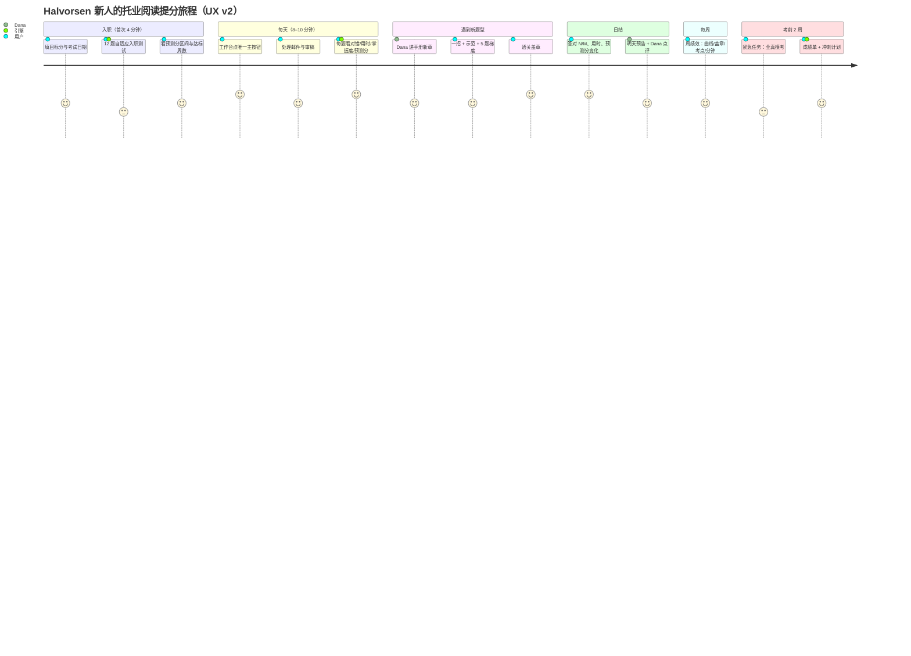
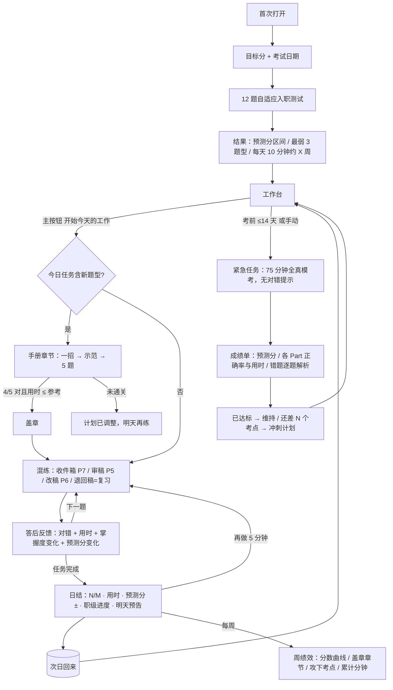

# 用户旅程（UX v2）

依据 docs/ux/UX_SPEC_v2.md §3 旅程、§4 信息架构、§5 手册、§7 关键屏。**v2 尚未实现**，线上 demo 为 v1.2；引擎动作列中的函数均已存在（docs/engine_api.md）。

## 1. 旅程体验图

## 2. 主流程

## 3. 分阶段说明

| 阶段 | 用户问题 | 界面回答 | 引擎动作 | 指标 |
|---|---|---|---|---|
| 入职 | 我几分？要多久？ | 目标/日期两步 → 12 题测试 → 区间、分段、最弱 3 题型、“每天 10 分钟约 X 周达标”；只显示“新人”和区间，不显示低分大字 | 诊断自适应选题（按词汇定起点）；`predict` 初始区间；`Planner.need` 最小考点集；`getProgress` 时长区间 | 入职完成率、耗时 ≤4 分钟、D1 留存 |
| 每天 | 今天干什么？ | 工作台：预测分卡（分数±区间、目标条、距考天数、职级）+ 唯一主按钮“约 8 分钟 · 2 封邮件 · 6 句审稿”+ 今日 3 项（为什么现在练 + 约 +N 分/时） | `getTodayPlan(state, min)` ROI 排程；`dueItems/dueWords` 到期复习混入（≤20）；回流日减量 | 首页 5 秒测试、主按钮点击率、日活/周活天数 |
| 新题型 | 怎么做最快？ | Dana 递《新人工作手册》新章：60 秒一招 → 示范题逐步高亮 → 5 题（基础2/进阶2/真考1）→ 盖章 | 首次遇到该题型前解锁；按分段决定章节顺序（<500 先 P5，650+ 先 P7）；混练命中时提示章号，连续 3 次快对后不再提示 | 章节通关率、通关后同题型正确率提升、用时下降 |
| 做题 | 快吗？对吗？ | 顶栏场景+人物、总用时、本题 Xs/参考 Ys（80% 琥珀、超时橙红）；P7 手机文/题切换，PC 左文右题 | 计时；高出当前水平半档出题（成功率 70–80%） | 单题用时 vs 参考、放弃率 |
| 答后 | 我进步了吗？ | 红绿 ✓✗ → “答对了 · 正确答案 D · 用时 12s” → 人物一句话为什么 → 掌握度条 50%→58% → 预测分 ±x → 看详细解析 → 下一题（不自动跳） | `recordAnswer` 写日志 + FSRS 自动评分 + 掌握度更新；`API.predict` 增量 | 3 秒内闭环、解析展开率 |
| 日结 | 值吗？ | 答对 N/M、用时 vs 参考、预测分 ±x（滚动）、职级进度、手册盖章、明天预告、Dana 一句点评、次按钮“再做 5 分钟” | 汇总当日事件；生成次日预告（焦点考点 + 到期复习） | 完成率、再做 5 分钟点击率、次日回访 |
| 每周 | 有进步吗？ | 周绩效：预测分曲线、盖章章节、攻下考点、累计分钟 | 事件日志周聚合；职级按预测分档 | 周留存、每分钟预测分增益（北极星） |
| 考前 2 周 | 够不够？ | 紧急任务=全真模考（75 分钟倒计时，过程无对错）→ 成绩单 → 错题列表 → 逐题解析 → “已达标/还差 N 个考点”冲刺计划 | 考前阶段 sprint/final3/examday；FSRS 压缩间隔对准考试日；模考结果作为 predict 输入；考后可填实考分校准 | 模考完成率、预测 vs 实考误差 |
